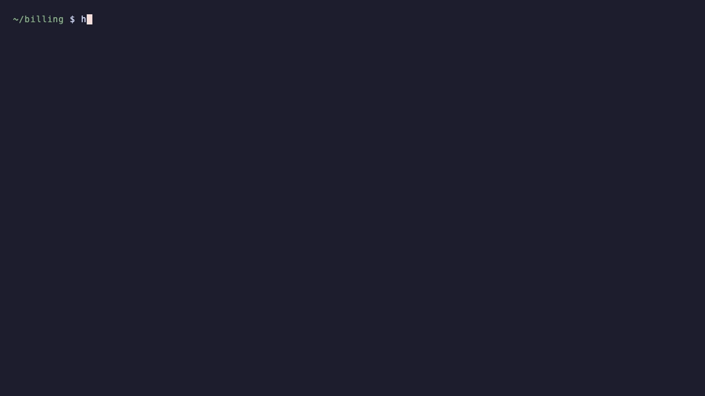
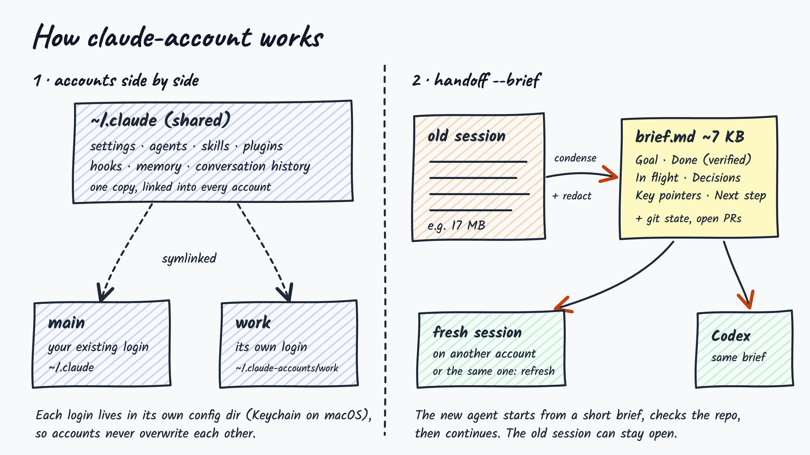

# claude-account

[](https://github.com/orvi2014/claude-account/actions/workflows/test.yml)
[](LICENSE)


Multiple Claude Code accounts on one machine, with session handoff between them.

`claude-account` keeps each Claude Code account signed in at the same time and moves work between them — by resuming a conversation, or by starting a fresh session from a compact, repository-aware handoff brief. The same brief can restart an overgrown session on the same account, or seed an OpenAI Codex session.

<p align="center">
  
</p>

<sub>Recorded in a sandbox with example accounts and a stand-in for <code>claude</code>; reproduce with <code>bash demo/setup.sh && vhs demo/demo.tape</code>.</sub>

---

## Contents

- [Features](#features)
- [Requirements](#requirements)
- [Setup](#setup)
- [Usage](#usage)
- [Command reference](#command-reference)
- [Handoff modes](#handoff-modes)
- [The handoff brief](#the-handoff-brief)
- [How it works](#how-it-works)
- [Security and privacy](#security-and-privacy)
- [Limitations](#limitations)
- [Development](#development)
- [Changelog](#changelog)
- [License](#license)

---

## Features

- **Concurrent accounts.** Every account stays signed in; run two accounts in two terminals at once.
- **Shared environment.** Settings, agents, skills, plugins, hooks, memory and conversation history are shared across accounts. Only the login differs.
- **Switch in place.** `switch` moves the current conversation to another account. In tmux (including desktop apps that host tabs in tmux), Terminal.app and iTerm2, the same tab restarts on the new login with its history intact.
- **Default account.** `default` (or `--default`) picks the account plain `claude` starts on; `setup-shell` installs the one-line hook for zsh, bash or fish.
- **Per-folder accounts.** `pin acme` in a client's folder and every `claude` started there uses that client's account.
- **Codex per account.** Each account can have its own Codex login; `handoff codex` uses the one that belongs to the session's account.
- **Private history.** Accounts can keep their conversations and memory to themselves, for client work that must stay separate.
- **One-line install and `update`.** The installer sets up `PATH`, the shell hook and the slash commands; outdated slash commands are flagged.
- **Session handoff.** Continue a conversation on another account with `--resume`, or fork a copy of it.
- **Brief handoff.** Start a fresh session from a structured summary instead of replaying the full history.
- **Refresh.** Restart a session that has grown too long, on the same account, from its brief.
- **Repository-aware briefs.** Branch, uncommitted changes, recent commits and your open pull requests are collected at handoff time and treated as ground truth.
- **Review before launch.** Open the brief in your editor and correct it before the new agent sees it.
- **In-session `/handoff` and `/switch`.** A running Claude Code session writes its own brief, from full context, at no extra cost, or moves itself to another account.
- **Codex handoff.** Seed an OpenAI Codex session with the same brief.
- **Live-session protection.** Refuses to resume a conversation that is still open in another window.
- **Secret redaction.** Passwords, API keys, tokens and private keys are removed before a transcript is summarised.

## Requirements

| | |
|---|---|
| Operating system | macOS or Linux |
| Shell | Bash 3.2 or later (the macOS default works) |
| Runtime | Python 3 |
| Claude Code | [`claude`](https://docs.anthropic.com/en/docs/claude-code) on your `PATH` |
| Optional | [`gh`](https://cli.github.com) for open pull requests in briefs · [`codex`](https://github.com/openai/codex) for `handoff codex` · `tmux` for switching a session in place |

## Setup

### 1. Install

```sh
curl -fsSL https://raw.githubusercontent.com/orvi2014/claude-account/main/install.sh | bash
```

This installs `claude-account` to `~/.local/bin`, adds that folder to your `PATH` if needed, installs the default-account shell hook and the `/handoff` and `/switch` commands. Open a new terminal afterwards. Every change is marked and reversible (see [Uninstall](#uninstall)).

Options go after `bash -s --`, for example `curl -fsSL …/install.sh | bash -s -- --no-shell`:

| Option | Effect |
|---|---|
| `--no-shell` | Do not edit shell startup files (no `PATH` line, no default-account hook). |
| `--no-commands` | Do not install `/handoff` and `/switch`. |
| `--bin-dir <dir>` | Install somewhere other than `~/.local/bin`. |

Update later with `claude-account update`. It also refreshes the slash commands.

<details>
<summary>Install by hand</summary>

```sh
mkdir -p ~/.local/bin
curl -fsSL https://raw.githubusercontent.com/orvi2014/claude-account/main/bin/claude-account \
  -o ~/.local/bin/claude-account
chmod +x ~/.local/bin/claude-account
```

If `~/.local/bin` is not on your `PATH`, add it to your shell profile.
</details>

<details>
<summary>Install from a clone instead</summary>

```sh
git clone https://github.com/orvi2014/claude-account.git
ln -s "$PWD/claude-account/bin/claude-account" ~/.local/bin/claude-account
```

`git pull` in the clone (or `claude-account update`) then updates the command.
</details>

### 2. Verify

```sh
claude-account list
```

Your existing Claude Code login appears as `main`. It is used as-is and never modified.

### 3. Add a second account

```sh
claude-account add work
```

A browser window opens. Sign in with the **other** account — if the browser is already signed in to your main account, use a private window. Pass `--email you@company.com` to prefill the address, or `--console` to use an Anthropic Console (API billing) login.

```sh
claude-account list
#   main   you@personal.com   (~/.claude)
#   work   you@company.com
```

### 4. Let plain `claude` follow a default account (optional)

```sh
claude-account setup-shell          # adds a guarded hook to your shell's startup file
claude-account default work         # plain `claude` now starts on "work"
```

`setup-shell` detects zsh, bash or fish (override with `--shell`), is safe to run twice, and is undone with `setup-shell --remove`. Open a new terminal afterwards.

### 5. Enable `/handoff` inside Claude Code (optional)

```sh
claude-account install-command
```

This adds `~/.claude/commands/handoff.md` and `switch.md`, which every account shares. In any Claude Code session you can then run `/switch work`, `/handoff work`, `/handoff codex` or `/handoff`.

### Uninstall

```sh
claude-account setup-shell --remove # if you added the shell hook
claude-account remove work          # repeat for each added account (also signs out its Codex login)
rm -f ~/.local/bin/claude-account ~/.claude/commands/handoff.md ~/.claude/commands/switch.md
rm -r ~/.claude-accounts            # saved briefs
```

The installer's `PATH` line is marked `# claude-account PATH` in your shell profile; delete that line too.

## Usage

**Work on another account**

```sh
claude-account use work             # or simply: claude-account work
claude-account main                 # back to the main account (~/.claude)
```

Run each in its own terminal to use both at once. `claude-account whoami` shows which account the current shell or Claude session is on, and which one a new `claude` starts on (inside Claude Code, `! claude-account whoami` or `/status`).

**Switch the account of the current conversation**

Inside Claude Code:

```text
! claude-account switch work            # or /switch work (after install-command)
! claude-account switch work --default  # also make "work" the default for new sessions
```

A running Claude Code process cannot change its login, so `switch` restarts it: the same conversation (full history, same ID) resumes on the other account, in the **same tab**:

| Where the session runs | What happens |
|---|---|
| tmux, including desktop apps that host each tab in tmux | The pane restarts in place, keeping its original flags, hooks and MCP config. |
| Terminal.app or iTerm2 (macOS) | Claude exits and the resume command is typed into that tab. macOS asks once to let your terminal control Terminal/iTerm2. |
| Anything else | Type `/exit`, then run `claude-account switch work` in that terminal. |

Run from a different terminal, `switch` restarts the session in its own tab when it can, and otherwise closes it there and resumes it in the terminal you ran it from.

**Choose the default account**

```sh
claude-account default work         # plain `claude` now starts on "work"
claude-account use work --default   # set it and start a session
claude-account default main         # back to ~/.claude
claude-account default              # show the current default
```

The first time you set a default, `claude-account` offers to add a one-line hook to your shell's startup file (`~/.zshrc`, `~/.bash_profile` / `~/.bashrc`, or fish `conf.d`) so plain `claude` follows it. The hook reads the default on every call, so changing it later needs no reload. An explicit `CLAUDE_CONFIG_DIR` always wins.

**Pin a folder to an account**

```sh
cd ~/clients/acme && claude-account pin acme   # plain `claude` here, and in every subfolder, starts on "acme"
claude-account pin                             # show which pin applies here
claude-account pin main                        # this folder uses main, whatever the default
claude-account pin --clear                     # remove this folder's pin
```

`pin` writes a one-line `.claude-account` file. Inside a git repository it is added to the repository's local ignore (`.git/info/exclude`), so it is never committed. The nearest pin wins, so a subfolder can pin a different account. Order of precedence for a plain `claude`: an explicit `CLAUDE_CONFIG_DIR`, then the nearest pin, then the default account, then `main`. `whoami` shows which one applies and why, and `refresh` and `handoff codex` follow it too. Pins work through the same shell hook as the default.

**Move a task to another account**

```sh
claude-account sessions             # conversations in this folder, and where each is open
claude-account handoff work --brief # fresh session on "work", seeded with a brief
claude-account handoff work         # or resume the full conversation (close the original first)
```

**Restart a session that has grown too long**

```sh
claude-account refresh              # brief + fresh session on the same account
claude-account refresh --edit       # review the brief in $EDITOR first
```

**Hand off from inside a running session**

```text
/handoff work
```

Claude writes the brief from its own context, saves it, and prints the command to continue — for example `claude-account handoff work --from ~/.claude-accounts/.briefs/….md`.

**Continue in Codex**

```sh
claude-account handoff codex
```

**Give each account its own Codex login**

```sh
claude-account codex-login acme      # sign "acme" in to its Codex (ChatGPT/OpenAI) account
claude-account codex acme            # start Codex on acme's login
claude-account handoff codex         # uses the session's account's Codex login when it has one
claude-account handoff codex --as acme
```

Each account's Codex login lives in its own `CODEX_HOME` (`~/.claude-accounts/<name>/codex`). `config.toml`, `AGENTS.md`, prompts, rules, skills and plugins are shared with `~/.codex`; the login, history and sessions are not. `main` uses `~/.codex`. `add acme --codex` signs in to both at once, and `list` shows each account's Codex email.

**Keep a client's conversations to its own account**

```sh
claude-account add acme --private    # new account with its own history and memory
claude-account private acme          # or convert an existing one
claude-account private acme --off    # share history again (only while its own history is empty)
```

By default every account shares conversation history. A private account keeps its conversations and memory in its own `projects/` folder, so other accounts never read them; settings, skills and MCP servers are still shared. `sessions`, `brief` and `handoff` see private conversations too. When you deliberately hand one to another account, it is copied into that account's history and the command says so.

**Work with saved briefs**

```sh
claude-account briefs                          # list, with each brief's goal
claude-account handoff work --from <file>      # start any account from a saved brief
claude-account brief --edit                    # write, review and print a brief without switching
```

## Command reference

| Command | Description |
|---|---|
| `add <name> [--email <addr>] [--console] [--private] [--codex]` | Create an account profile and sign in. `--private` keeps its history to itself; `--codex` also signs it in to Codex. |
| `private <name> [--off]` | Give an existing account its own history and memory, or share again. |
| `codex-login <name\|main>` | Sign an account in to its own Codex login. |
| `codex <name\|main> [codex args…]` | Start Codex on that account's Codex login. |
| `use <name> [--default] [claude args…]` | Start Claude Code on an account. `claude-account <name>` is equivalent. `--default` also makes it the default. |
| `main [claude args…]` | Start Claude Code on the main account (`~/.claude`). |
| `switch <target> [id] [--default] [--yes]` | Continue a conversation on another account, restarting it in its own tab (tmux, Terminal.app, iTerm2) or resuming it here. |
| `default [name\|main]` | Show or set the account plain `claude` starts on. |
| `pin [name\|main\|--clear]` | Pin the current folder and its subfolders to an account, show the pin, or remove it. |
| `setup-shell [--remove] [--shell zsh\|bash\|fish]` | Install or remove the hook that makes plain `claude` follow the default. |
| `shell-init [zsh\|bash\|fish]` | Print that hook. |
| `list` | List accounts and the email each is signed in as. |
| `whoami` | Show the account this shell or session is on, and the one new sessions start on. |
| `--version` | Print the version. |
| `login <name>` | Sign an account in again. |
| `remove <name>` | Sign out and delete a profile; shared files are kept. |
| `sessions [n]` | Recent conversations in the current folder and where each is open. |
| `handoff <target> [id] [--fork]` | Resume a conversation on another account. |
| `handoff <target\|codex> [id] --brief [--as <name>]` | Start a fresh session there from a brief. For Codex, `--as` picks whose Codex login to use. |
| `refresh [id]` | Brief and fresh session on the same account. |
| `brief [id]` | Write and print a brief without switching. |
| `briefs [n]` | List saved briefs. |
| `install-command [--force]` | Install or update the `/handoff` and `/switch` commands. `--force` also replaces files it did not write. |
| `update` | Update claude-account (a clone is updated with `git pull`) and its slash commands. |

`<target>` is an account name or `main`. Without an `id`, the most recent conversation in the current folder is used; IDs are listed by `sessions`.

**Brief options** (for `handoff --brief`, `refresh` and `brief`):

| Option | Effect |
|---|---|
| `--edit` | Open the brief in `$VISUAL` / `$EDITOR` before it is used. |
| `--from <file>` | Use a saved brief instead of writing a new one. |
| `--model <name>` | Model that writes the brief (default `sonnet`). |
| `--no-repo` | Leave out repository state. |

Commands that start Claude Code need a terminal; they will not run through Claude Code's `!` prefix. `switch` is the exception.

When the installed `/handoff` or `/switch` is older than the current templates, `list`, `whoami` and the handoff commands print a one-line note to run `claude-account install-command`.

## Handoff modes

| | `--resume` (default) | `--fork` | `--brief` / `refresh` |
|---|---|---|---|
| New session starts with | the full conversation | a copy of the full conversation | a structured brief |
| Context loaded | entire history | entire history | typically 1–3k tokens |
| Original session | must be closed | may stay open | may stay open |
| Targets | Claude Code | Claude Code | Claude Code or Codex |
| Fidelity | exact | exact | summarised, then verified against the repository |

Use `--resume` when exact continuity matters. Use a brief for long sessions, when the original is still running, or when moving to Codex. In testing, a 17 MB compacted session produced a brief of about 7 KB.

## The handoff brief

A brief is Markdown with fixed sections:

| Section | Contents |
|---|---|
| Goal | What the user asked for, in their words where possible |
| Done (verified) | Completed work with evidence: pull requests, commits, deploys, test results |
| In flight | The step in progress when the session stopped |
| Decisions and constraints | Choices and rules the user set, quoted when strict |
| Tried and rejected | Approaches that were tried or considered and dropped, with the reason, so they are not repeated |
| Key pointers | Repositories, branches, files, commands, URLs and IDs |
| Open questions / blockers | Anything blocked or waiting on the user |
| Next step | One or two concrete first actions |

The receiving agent is told to verify the repository before relying on the brief, and to confirm with the user before any destructive or outward-facing action.

**Two ways to write one**

| | `claude-account brief` / `--brief` | `/handoff` inside Claude Code |
|---|---|---|
| Written by | a separate `claude -p` call | the running session itself |
| Input | condensed transcript + repository state | full live context + repository state |
| Billed to | the account receiving the handoff | the current account |
| Works after the session has closed | yes | no |

**How the transcript is condensed.** The input reflects what the model actually had in context: the latest compaction summary, the messages Claude Code retained verbatim when it compacted, and everything after. It keeps user messages, assistant replies, one-line tool calls and tool errors, and drops side chains, system reminders and tool output. Repository state is appended as a block the model treats as ground truth. The `claude -p` call uses a dedicated system prompt with tools, MCP servers and project settings disabled.

Briefs are saved to `~/.claude-accounts/.briefs/` with mode `600`.

## How it works

<p align="center"></p>

- **Isolation.** Each account is a separate [`CLAUDE_CONFIG_DIR`](https://docs.anthropic.com/en/docs/claude-code/settings) under `~/.claude-accounts/<name>`. Claude Code stores one login per configuration directory — in the macOS Keychain, or in the directory itself on Linux — so accounts never overwrite each other. The default account runs with `CLAUDE_CONFIG_DIR` unset.
- **Sharing.** `settings.json`, `settings.local.json`, `CLAUDE.md`, `agents/`, `skills/`, `plugins/`, `commands/`, `hooks/` and `projects/` are symlinked from `~/.claude`. User-scope MCP servers are copied once when an account is added.
- **Session discovery.** Conversations are read from the shared `projects/` directory. Open sessions are detected from each account's session registry and confirmed by process ID.
- **Switching.** A running Claude Code process cannot change its login, so `switch` restarts it with `--resume` under the other account. If the session's registry entry names a tmux pane, the restart is scheduled through the tmux server (`respawn-pane`), so it works from inside the session and keeps the pane's original start command. Otherwise the session is asked to exit (`SIGTERM`) and resumed in the terminal that ran `switch`.
- **Private history.** A private account has a real `projects/` folder instead of the shared symlink, and a `.private` marker so it is never re-linked. Session discovery scans every distinct history folder.
- **Codex.** Codex reads its login from `$CODEX_HOME`; each account gets `~/.claude-accounts/<name>/codex`, with configuration symlinked from `~/.codex`. The Codex email shown by `list` is read from the login's ID-token claims; tokens are never printed or copied.
- **Default account and pins.** The default is a name in `~/.claude-accounts/.default`; a pin is a `.claude-account` file holding an account name. The shell hook defines a `claude` function that, on every call, looks for the nearest `.claude-account` from the current folder upwards, falls back to the default, and sets `CLAUDE_CONFIG_DIR` only when it is not already set. It uses shell builtins for the folder walk, so it adds no noticeable start-up time.

## Security and privacy

- No credentials are read, copied or modified; sign-in is handled entirely by Claude Code.
- Before summarisation, labelled passwords, API keys (Anthropic, OpenAI, GitHub, Slack, AWS, Google), JWTs and private keys are replaced with `[redacted]`. Redaction is pattern-based; an unlabelled secret in free text may not be caught.
- Condensed transcripts are sent only to Claude, through your own Claude Code login.
- Unless an account is `--private`, `projects/` is shared, so every account can read every conversation. Use private accounts where clients must be kept separate. Settings, `CLAUDE.md`, skills and MCP servers are still shared.

## Limitations

- **Terms of use.** Holding more than one account for your own use is common. Creating accounts to evade usage limits, or sharing or reselling accounts, is not permitted under Anthropic's policies. This tool never switches accounts automatically and is not intended for that purpose.
- **Summaries are lossy.** A brief can omit detail; review the first actions of a session started from one.
- **Unofficial.** Claude Code's on-disk session format is not a public interface and may change between versions.

## Development

```sh
bash tests/run.sh                          # 130 tests
bash demo/setup.sh && vhs demo/demo.tape   # re-record the demo GIF (requires vhs)
```

The test suite is self-contained: a temporary `HOME`, stand-in `claude`, `codex`, `gh`, `tmux`, `osascript`, `curl` and editor executables, and synthetic session files. It never touches your real configuration or credentials. CI runs it on Ubuntu and macOS.

Issues and pull requests are welcome.

## Changelog

See [CHANGELOG.md](CHANGELOG.md).

## License

[MIT](LICENSE)
